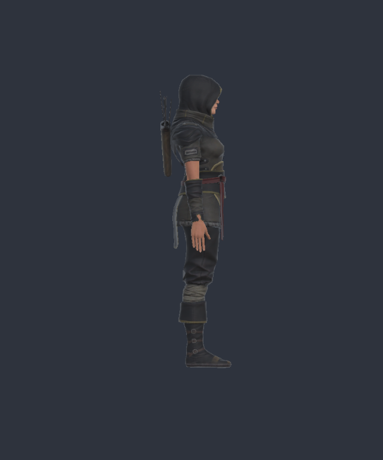
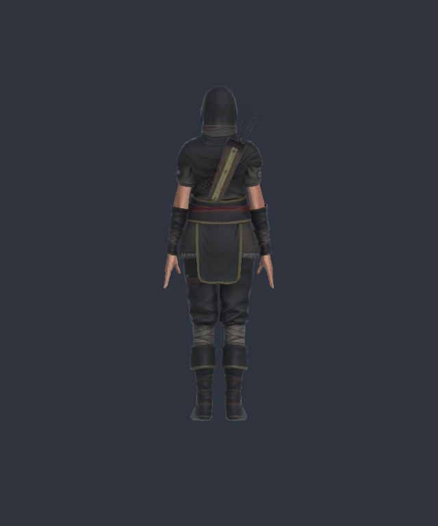

# Prototype archer design

English Archer and Erika Archer are the prototype visual choices: realistic
medieval humans with adult proportions and light clothing/armor. English uses
cloth, short mail sleeves and an open helmet; Erika uses a hood, cloth/leather
and exposed arms. The knight and other retained bases are not player selections.
Both preview bodies are provisionally 1.75 m tall; this is a review scale, not
final anatomy or bow calibration. Multiple different archer models remain allowed.

## First-person and opponent views

The local player uses first person in the Quest headset and sees tracked
hands/controllers only for this prototype. The current tracking prefab shows
controller markers; final hand meshes and bow interaction are separate work.
The opponent appears as a full archer. No local full-body mesh or forced
third-person camera is part of this prototype decision.

Body-specific knockdown animates the opponent's full character. The local injury
view follows the character's eyes through falls, kneeling and recovery, with
live headset tracking for looking around. This viewpoint choice needs Quest 2
validation. The confirmed rules and reactions are in
[injury reactions](../InjuryReactions.md).
The prepared rigs supply an animated `EyeAnchor`; final physical camera calibration
and comfort remain headset checks.

## Model reference sheet

These appearance-review views record the models before rig preparation, with
their actual textures and source geometry. English's separate bow/arrow are
reference props. Current derivatives and movement checks are documented in
[rig preparation](RigPreparation.md). Views show front, anatomical right side
and back.

| Model | Front | Side | Back |
| --- | --- | --- | --- |
| English Archer |  |  |  |
| Erika Archer |  |  |  |

## Bow and hit-region design review

Both outfits leave hands, shoulders and left/right limb silhouettes identifiable.
Both now have prepared Humanoid derivatives with body, eye and finger mappings.
The shared movement check verifies skinning and support-foot contact. Per-region
injury clips and their full contact/deformation review remain separate tasks.

| Required region | Design check and preparation consequence |
| --- | --- |
| Head | Head silhouette is distinct. English's helmet and Erika's hood must map to the actual head region rather than hide it from hit detection. |
| Neck | Keep a separate neck volume below the head; both regions are fatal but require distinct death animations. |
| Chest | Tunic/chest silhouette is visible; align a future chest hitbox to the body rather than the broad test capsule. |
| Abdomen | Waist belts and pouches are equipment, not a replacement for locating the underlying body impact. |
| Pelvis | Separate the hip/groin area from abdomen and thighs; clothing must deform through the supported seated fall. |
| Left/right shoulders | Use separate shoulder-cap regions and animations, with the opposite hand contacting the injured shoulder. |
| Left/right arms | Upper arm, elbow and forearm use the supported-arm reaction; keep shoulders and hands separate. |
| Left/right hands | Separate wrist/hand volumes and finger movement; the opposite hand supports the injured wrist. |
| Left/right legs | Thigh, knee and shin use side-specific kneeling; skirt/tunic sections need skinning checks. Feet remain separate. |
| Left/right feet | Foot/toe volumes and lifted-foot reactions are separate from leg kneeling; check balance on the healthy leg and later floor contact. |

This checks visual identification and preparation requirements. It does not claim
implemented body hitboxes, damage values, draw deformation or injury reactions.
Back geometry remains part of the character model and reference views; back hits
are outside the facing-archer bow duel's current hit-region inventory.
The complete fifteen-region reaction inventory is defined in task #17 and the
linked table. Validate the provisional 0.70 m draw, hand contacts, quiver clearance
and recovery poses in [task #18](https://github.com/matheusluciano99/Bow-Man-VR/issues/18)
and the bow/hardware tasks.

## Sourcing and implementation boundaries

Sources, licenses, attribution and measured rig status are maintained in
[CharacterAssets.md](CharacterAssets.md). Use the official sources recorded there;
keep original archives local and commit prepared runtime files with metadata.
The source English mesh stays static; the active prefab uses its prepared skinned
derivative. Erika's derivative repairs source hand weights. The normal prefabs
keep neutral poses and the duel still has simple capsule shot targets; gameplay
animations, precise hitboxes and their individual checks remain later work.
