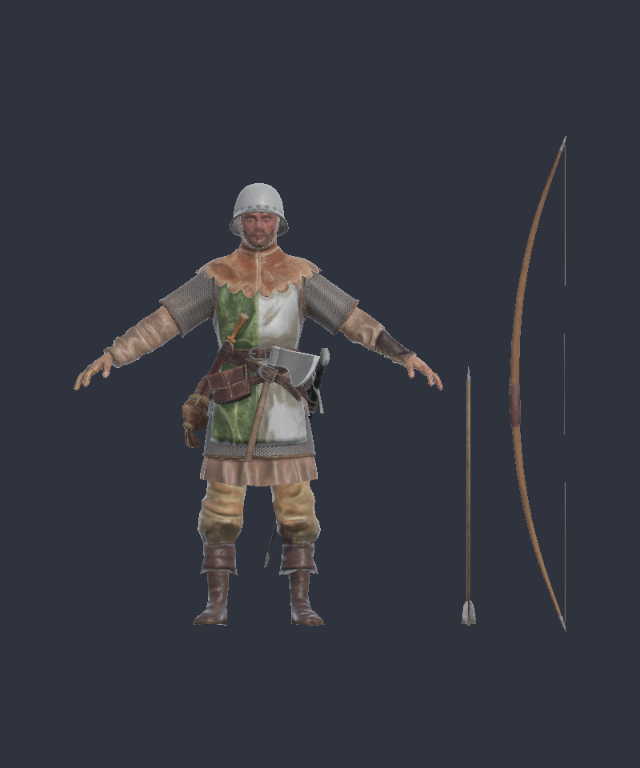
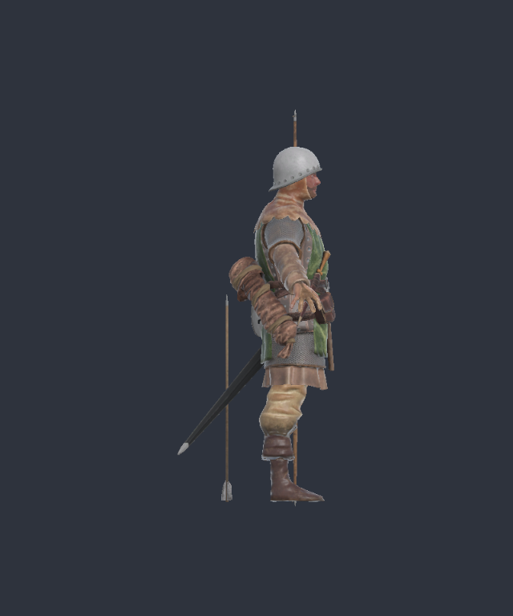
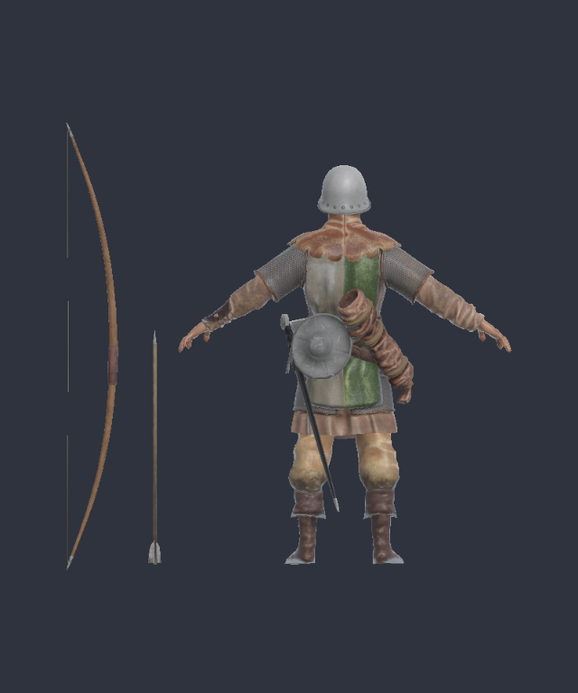
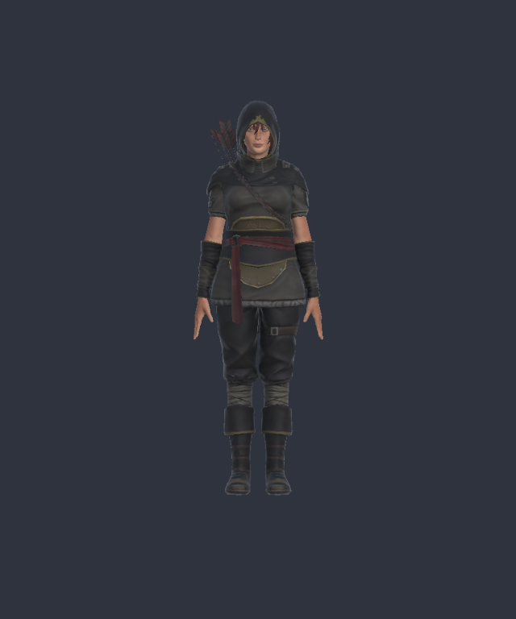

# Prototype archer design

English Archer and Erika Archer are the prototype visual choices: realistic
medieval humans with adult proportions and light clothing/armor. English uses
cloth, short mail sleeves and an open helmet; Erika uses a hood, cloth/leather
and exposed arms. The knight and other retained bases are not player selections.
Both preview bodies are provisionally 1.75 m tall; this is a review scale, not
final anatomy or bow calibration. Multiple different archer models remain allowed.

## First-person and opponent views

The local player uses first person in the Quest headset and sees tracked
hands/controllers only for this prototype. The current tracking prefab shows
controller markers; final hand meshes and bow interaction are separate work.
The opponent appears as a full archer. No local full-body mesh or forced
third-person camera is part of this prototype decision.

Body-specific knockdown animates the opponent's full character. The local injury
view follows the character's eyes with live headset tracking, as agreed in
[task #17](https://github.com/matheusluciano99/Bow-Man-VR/issues/17). The prepared
rigs supply an animated `EyeAnchor`; physical camera calibration and comfort
still need headset testing.
The confirmed rules are in [injury reactions](../InjuryReactions.md).

## Model reference sheet

These appearance-review views record the models before rig preparation, with
their actual textures and source geometry. English's separate bow/arrow are
reference props. Current derivatives and movement checks are documented in
[rig preparation](RigPreparation.md). Views show front, anatomical right side
and back.

| Model | Front | Side | Back |
| --- | --- | --- | --- |
| English Archer |  |  |  |
| Erika Archer |  |  |  |

## Bow and hit-region design review

Both outfits leave hands, shoulders and left/right limb silhouettes identifiable.
Both now have prepared Humanoid derivatives with body, eye and finger mappings.
The shared movement check verifies skinning and support-foot contact. Per-region
injury clips and their full contact/deformation review remain separate tasks.

| Required region | Design check and preparation consequence |
| --- | --- |
| Head | Head silhouette is distinct. English's helmet and Erika's hood must map to the actual head region rather than hide it from hit detection. |
| Neck | Its own region and fatal animation, separate from the head. The prepared neck/head bones also carry the eye reference. |
| Chest | Tunic/chest silhouette is visible; the bone-bound chest volume replaces the broad test capsule. |
| Abdomen | Waist belts and pouches are equipment, not a replacement for locating the underlying body impact. |
| Pelvis | Its own region and supported seated fall; clothing needs contact/deformation review. |
| Left/right shoulders | Separate shoulder-cap regions and reactions; validate opposite-hand contact. |
| Left/right arms | Upper arm, elbow and forearm use supported-arm reactions, excluding shoulders and hands. |
| Left/right hands | Separate wrist/hand regions and finger motions, including the opposite hand's support contact. |
| Left/right legs | Separate kneeling reactions; validate injured-side knee and same-side supporting hand contacts. |
| Left/right feet | Separate lifted-foot reactions; the movement check verifies alternating-foot support. |

This checks visual identification and preparation requirements. Provisional
body volumes and impact reporting are now implemented in [body hit detection](../BodyHits.md).
Damage values, draw deformation and injury reactions remain separate work.
The fifteen-region inventory and reactions are agreed in task #17. Back hits are
outside the facing-archer bow duel; the back views remain useful art references.
Validate the provisional 0.70 m draw, hand contacts, quiver clearance
and recovery poses in [task #18](https://github.com/matheusluciano99/Bow-Man-VR/issues/18)
and the bow/hardware tasks.

## Sourcing and implementation boundaries

Sources, licenses, attribution and measured rig status are maintained in
[CharacterAssets.md](CharacterAssets.md). Use the official sources recorded there;
keep original archives local and commit prepared runtime files with metadata.
The source English mesh stays static; the active prefab uses its prepared skinned
derivative. Erika's derivative repairs source hand weights. The normal prefabs
keep neutral poses; the duel uses bone-bound anatomical shot volumes. Gameplay
animations and pose-specific volume/contact refinements remain later work.
