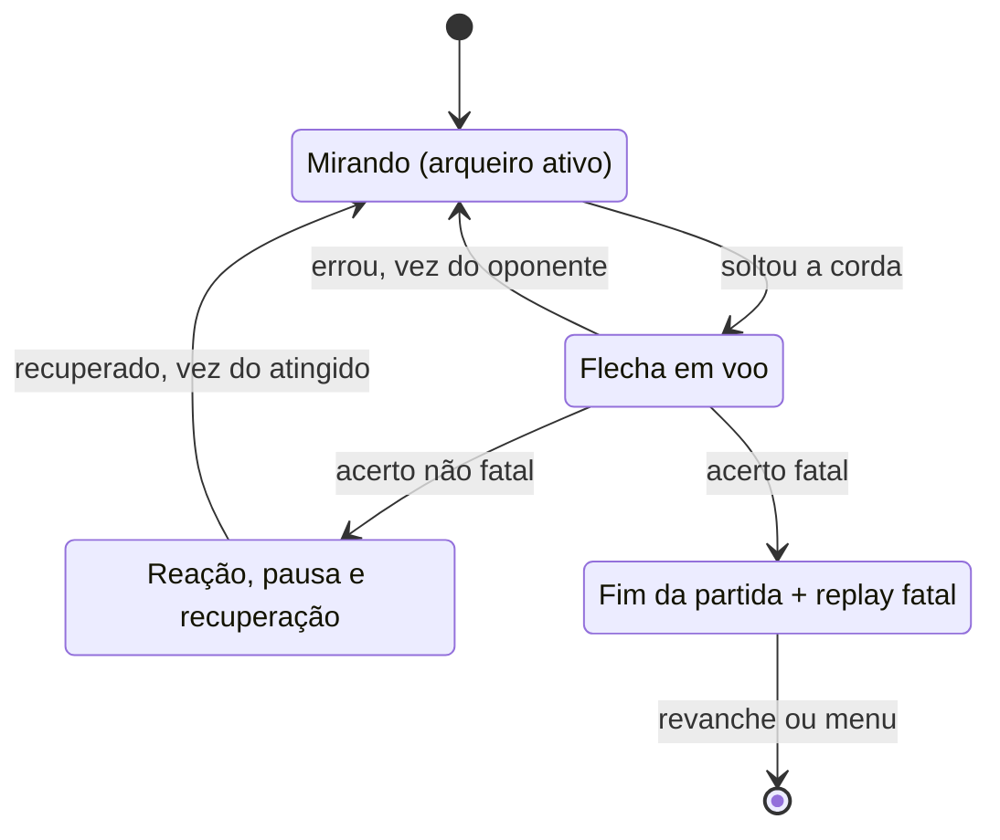

# Bow Man VR — Game Design Document

> **Documento vivo.** Este GDD descreve o jogo como ele é hoje, o que está em
> revisão e as mudanças de direção ao longo do desenvolvimento. Ele é atualizado
> no mesmo pull request que muda a jogabilidade, o conteúdo, os controles, o
> escopo ou a distribuição (veja [Manutenção](#19-manutenção-deste-documento)).

| | |
| --- | --- |
| **Versão** | 1.1 — 24/11/2026 |
| **Gênero** | Duelo de arco e flecha por turnos, em realidade virtual |
| **Plataforma de entrega** | Navegador com WebXR, publicado como jogo HTML no itch.io (exigência da disciplina) |
| **Plataforma de laboratório** | PC com Windows + Meta Quest 2 via Quest Link |
| **Controles** | Dois controles Touch rastreados (headset obrigatório) |
| **Jogadores** | 1 (contra IA ou CPU) ou 2 online, em redes diferentes |
| **Motor** | Unity 6000.3.25f1 (URP), OpenXR e WebXR |
| **Equipe e prazo** | 2 desenvolvedores, 2 semanas (início em 11/11/2026) |
| **Tarefas** | [Quadro Kanban no GitHub](https://github.com/users/matheusluciano99/projects/1) |
| **Cópia pública** | [Página de leitura](https://claude.ai/artifact/QnVwUpKP5CYNaeDRvZfDSy) para quem não tem acesso ao repositório |

**Sumário:**
[1. Visão geral](#1-visão-geral) ·
[2. Fluxo do jogo](#2-fluxo-do-jogo) ·
[3. Modos](#3-modos-de-jogo) ·
[4. Mecânicas](#4-mecânicas) ·
[5. Controles](#5-controles) ·
[6. Interface](#6-interface-e-feedback) ·
[7. Personagens](#7-personagens-e-perspectiva) ·
[8. Ambientes](#8-ambientes) ·
[9. Arte](#9-direção-de-arte) ·
[10. Áudio](#10-áudio) ·
[11. Multiplayer](#11-multiplayer-online) ·
[12. Tecnologia](#12-tecnologia-e-distribuição) ·
[13. Estado atual](#13-estado-do-desenvolvimento) ·
[14. Mudanças de trajetória](#14-histórico-de-mudanças-de-trajetória) ·
[15. Em aberto](#15-questões-em-aberto-e-valores-provisórios) ·
[16. Fora do escopo](#16-fora-do-escopo) ·
[17. Créditos](#17-créditos-e-licenças) ·
[18. Documentos](#18-documentos-relacionados) ·
[19. Manutenção](#19-manutenção-deste-documento)

---

## 1. Visão geral

### 1.1 Conceito

Bow Man VR traz para a realidade virtual o clássico *Bow Man*, em que dois
arqueiros se revezam atirando um no outro e a mira e a força definem a
trajetória da flecha. Aqui o jogador não digita ângulo nem força. Ele segura o
arco com uma mão, puxa a corda com a outra e solta. A flecha voa com física,
atinge um ponto real do corpo do adversário e ele reage conforme a região e o
lado atingidos. O acerto fatal encerra o duelo com um replay que mostra, por
dentro do corpo, o caminho que a flecha percorreu.

Além do duelo, o modo **Tiro ao alvo** oferece uma competição de precisão de
dez flechas por arqueiro, contra a CPU ou contra outra pessoa online.

**Em uma frase:** um duelo medieval de arqueiros em VR em que o seu braço é a
mira e cada flecha deixa uma consequência anatômica real.

### 1.2 Pilares de design

1. **O corpo é o controle.** Mirar, puxar e soltar são gestos físicos e a força
   vem da distância real da puxada. Não existe botão de "atirar". Por isso as
   cenas jogáveis exigem headset (seção 12).
2. **Cada flecha conta e nada é aleatório.** O ponto de impacto real define a
   região, o lado, o sangue, os órgãos, os ossos e a reação do corpo. Nenhum
   acerto usa uma animação genérica de "levou dano".
3. **Duelo legível por turnos.** Só existe uma flecha em jogo por vez. Ninguém
   atira enquanto uma flecha voa ou um arqueiro se recupera, e o HUD sempre
   indica de quem é a vez e qual é o próximo passo.
4. **Jogar com qualquer pessoa.** A partida online funciona entre redes
   diferentes (casa, campus, rede móvel) com um código de seis caracteres,
   direto no navegador.

### 1.3 Referências

| Referência | O que o jogo aproveita |
| --- | --- |
| *Bow Man* (clássico) | Duelo por turnos; trajetória definida por mira e força. |
| *For Honor*, *Conqueror's Blade* | Direção visual: humanos medievais realistas, com roupa ou armadura leve. |
| *The Last of Us* | Derrubada temporária após o acerto, seguida de recuperação. |
| *Sniper Elite* | Visualização anatômica (órgãos e ossos) do tiro que mata. |

### 1.4 Público e conteúdo

Jogadores com headset VR e navegador compatível com WebXR, sozinhos ou em
dupla. O jogo mostra sangue, flechas cravadas no corpo e lesões internas no
replay fatal; a classificação indicativa ainda não foi definida (seção 15).

---

## 2. Fluxo do jogo

### 2.1 Da página ao fim da partida

1. Na página do itch.io: **Play** e depois **Enter VR**.
2. No menu principal, no próprio mundo virtual, o jogador aponta o raio do
   controle direito e aperta o gatilho para:
   - escolher o arqueiro (**English Archer** ou **Erika Archer**);
   - escolher a mão que segura o arco (a outra puxa a corda);
   - escolher o modo: **PvE — vs AI archer**, **PvP — online duel** ou
     **Tiro ao alvo**;
   - abrir os **Credits**.
3. A partida acontece (seção 3).
4. No fim, o HUD mostra **VICTORY/DEFEAT**, o vencedor ou o empate. O botão **A**
   pede a revanche; online, ela começa quando os dois aceitam.
5. O botão **Menu** do controle esquerdo volta ao menu a qualquer momento
   (no navegador, clique no analógico esquerdo). Sair do modo online encerra a
   sessão.

O arqueiro e a mão do arco escolhidos ficam salvos no aparelho e valem para
todos os modos e revanches.

### 2.2 Um turno do duelo

1. **Sua vez.** O HUD mostra o próximo passo para a mão escolhida.
2. **Pegar a corda.** Segure o gatilho da mão que puxa e leve-a até a corda.
   Uma vibração leve confirma que a corda foi pega.
3. **Puxar.** A força cresce com a distância puxada para trás. Acima de 60% a
   corda começa a ranger; em 100% o HUD mostra **FULL DRAW** e o controle vibra.
4. **Mirar e soltar.** A direção vem da orientação do arco e da linha entre as
   duas mãos. Soltar o gatilho dispara a flecha.
5. **Voo.** A flecha registrada trava o arco dos dois arqueiros até o resultado.
6. **Resultado.**
   - Erro (cenário ou 8 s sem acertar nada): a vez passa ao oponente.
   - Acerto que não mata: o atingido faz a reação da região, fica na pose de
     ferido pelo tempo da região, se recupera e só então recebe a vez.
   - Acerto fatal: a partida termina na hora, o corpo cai e não se levanta, e
     começa o replay da flecha fatal.

Cada flecha é resolvida uma única vez. Destruir a flecha depois, impactos
repetidos ou animações atrasadas nunca passam a vez de novo.

---

## 3. Modos de jogo

| Modo | Jogadores | Objetivo | Quem começa | Revanche |
| --- | --- | --- | --- | --- |
| **PvE — vs AI archer** | 1 contra IA | Derrubar o oponente | Jogador | **A** reinicia |
| **PvP — online duel** | 2 online | Derrubar o oponente | Host (Arqueiro 1) | Os dois aceitam com **A** |
| **Tiro ao alvo** (CPU) | 1 contra CPU | Mais pontos em 10 flechas cada | Jogador | **A** reinicia |
| **Tiro ao alvo** (online) | 2 online | Mais pontos em 10 flechas cada | Host | Os dois aceitam com **A** |

### 3.1 PvE — duelo contra a IA

O jogador enfrenta um arqueiro controlado pela IA, com o outro modelo de
personagem, numa das três arenas sorteada para a partida. Os dois ficam frente
a frente, a 20 metros, numa faixa de tiro livre. A IA segue exatamente as
mesmas regras de turno, flecha e ferimento do jogador (seção 4.7).

### 3.2 PvP — duelo online

Um jogador escolhe **Host** e recebe um código de seis caracteres, que aparece
no painel e no headset. O outro escolhe **Join** e digita o código no teclado
virtual do headset. O host é o Arqueiro 1 e atira primeiro; quem entra é o
Arqueiro 2. Um terceiro jogador é recusado. O host sorteia a arena e a envia ao
outro jogador, também na revanche. Cada lado vê o próprio arco e o arqueiro
completo do adversário, inclusive puxando e soltando a corda.

Se um dos jogadores sair, o outro volta ao lobby. A regra de autoridade do host
está na seção 11.

### 3.3 Tiro ao alvo

Os dois arqueiros atiram, alternadamente, no mesmo alvo e da mesma linha de
tiro: dez flechas cada, vinte no total. Vence quem somar mais pontos; o empate
é possível.

- **Distâncias:** 15 m (padrão), 30 m, 50 m, 60 m ou 70 m. As duas primeiras
  servem de entrada para novos jogadores; as três últimas são os desafios de
  longa distância. Online, vale a distância escolhida pelo host, inclusive na
  revanche; para mudar, é preciso sair do lobby e hospedar de novo.
- **Contra a CPU:** escolha a distância e **Play against CPU**. O arqueiro da
  CPU fica à direita do jogador, usa o outro modelo de personagem, anima a
  própria puxada e dispara uma flecha física no alvo. O jogador atira primeiro.
- **Online:** usa o mesmo fluxo de host e código do PvP, em PCs separados, com
  lobby próprio. O host atira primeiro e pontua todas as flechas.
- **Flechas:** um erro ou uma flecha que expira gasta a flecha e vale zero.
  Cancelar a puxada não gasta a flecha.
- **Velocidade:** neste modo a força total lança a flecha a 32 m/s em todas as
  distâncias, para que o alvo de 70 m seja alcançável.
- **HUD:** os dois placares, as flechas restantes, de quem é a vez e uma cópia
  do alvo que marca o último ponto atingido (ou indica o erro).

A regra de pontuação está na seção 4.8.

---

## 4. Mecânicas

### 4.1 O arco

- O arco fica **preso à mão escolhida** o tempo todo, sem precisar segurar o
  grip, inclusive durante o turno do oponente e durante ferimentos. O padrão é o
  arco na mão esquerda e a puxada com a direita; o contrário também funciona.
- **Pegar a corda:** com o gatilho da outra mão pressionado, encoste a mão a até
  12 cm da corda em repouso. Uma vibração leve confirma.
- **Força:** proporcional à distância puxada **para trás**. Puxadas abaixo de
  3 cm, ou só para frente ou para o lado, não disparam. A força máxima chega a
  36 cm; puxar além disso não aumenta a força.
- **Mira:** orientação do arco e linha entre a corda puxada e o ponto de encaixe
  da flecha.
- **Disparo:** soltar o gatilho. A força total lança a flecha a 25 m/s no duelo.
- **Rastreamento instável:** se a mão que puxa some do rastreamento com o
  gatilho pressionado, o jogo mantém a última puxada válida e espera até 750 ms
  o sinal do gatilho voltar. Perder o rastreamento da mão do arco, pausar,
  perder o foco do headset ou o turno acabar **cancela** a puxada, sem disparo
  acidental.
- **Trocar a mão do arco:** no menu ou com **B** durante a própria vez de mirar;
  a troca cancela uma puxada em andamento.

| Parâmetro | Valor | Situação |
| --- | --- | --- |
| Puxada mínima para disparar | 3 cm | Protótipo |
| Puxada para força total | 36 cm | Provisório, ajustado no Quest 2 |
| Raio para pegar a corda | 12 cm | Protótipo |
| Velocidade com força total (duelo) | 25 m/s | Protótipo |
| Velocidade com força total (Tiro ao alvo) | 32 m/s | Definido para alcançar 70 m |
| Comprimento da flecha | 0,96 m | A ponta continua visível na puxada máxima |

### 4.2 A flecha e o impacto

- A flecha voa com gravidade. A cada passo de física, um raio varre o trecho
  percorrido pela ponta e o **primeiro contato sólido** é o impacto.
- No corpo, a flecha para no ponto exato de entrada e penetra 25 cm
  (valor de jogo, provisório). Ela fica presa ao osso atingido e acompanha a
  animação até a partida acabar.
- No cenário, a flecha fica cravada por até 3 s. Uma flecha que não acerta nada
  expira depois de 8 s.
- O sangue sai do ponto real da ferida e acompanha o membro; as gotas caem com
  gravidade (seção 9).

### 4.3 Vida, dano e morte

| Regra | Valor |
| --- | --- |
| Vida inicial de cada arqueiro | 100 |
| Dano de um acerto no corpo | 25 (provisório), ou seja, 4 acertos não fatais matam |
| Cabeça ou pescoço | Morte instantânea, com qualquer vida |
| Morte | A partida termina na hora; o corpo termina de cair e não se levanta |

Hoje órgãos e fraturas não alteram a vida nem a recuperação. Esses efeitos
estão em aberto (seção 15).

### 4.4 Regiões de acerto e reações

Os arqueiros sempre se enfrentam de frente, por isso há **15 regiões**, sem
costas. "Esquerda" e "direita" são sempre o lado anatômico de quem foi
atingido. Cada região tem sua própria reação, baseada em captura de movimento
real, nos dois personagens.

| Região | Reação | Se sobreviver |
| --- | --- | --- |
| Cabeça | Morte instantânea; desaba e perde a postura. | — |
| Pescoço | Morte instantânea; leva a mão à ferida, os joelhos cedem e cai. | — |
| Peito | Cai de costas no chão. | Pausa curta no chão e levanta (ver nota). |
| Ombro (E/D) | Recua do lado atingido, gira o tronco e segura o ombro com a outra mão, em pé. | 3 s, solta o ombro e volta à postura. |
| Braço (E/D) | Recua, dobra o braço e o apoia com a outra mão, em pé. | 3 s e recupera. |
| Mão (E/D) | Puxa a mão para trás, abre os dedos e apoia o pulso com a outra mão. | 3 s e volta à postura. |
| Abdômen | Dobra para frente, segura a ferida e cai de joelhos. | 3 s ajoelhado e levanta. |
| Pelve | O quadril cede e o arqueiro cai sentado, apoiado nas duas mãos atrás. | 3 s sentado e levanta. |
| Perna (E/D) | Ajoelha sobre a perna ferida e apoia a mão do mesmo lado no chão. | 3 s e levanta. |
| Pé (E/D) | Levanta o pé ferido e se equilibra na outra perna. | 2 s, apoia o pé e volta à postura. |

- **Nota do peito:** no `main`, a pausa no chão é de 0,75 s e o levantar leva
  3,6 s. O PR #165 propõe 0,2 s de pausa e 2,6 s para levantar, para o arqueiro
  não ficar parado no chão por tanto tempo.
- **Acerto fatal fora da cabeça e do pescoço:** a reação da região começa e
  termina numa queda completa, sem recuperação. Morrer durante uma recuperação
  interrompe o levantar e termina a queda a partir da pose atual.
- **Turno:** ninguém atira durante a reação, a pausa ou a recuperação. O
  arqueiro ferido recebe a vez só depois de se recuperar.

A tabela completa, os limites anatômicos de cada região e as fontes de cada
movimento estão em [InjuryReactions.md](InjuryReactions.md).

### 4.5 Anatomia: órgãos e ossos

- Cada personagem carrega, dentro do corpo, a geometria real de **13 órgãos**
  (atlas BodyParts3D): cérebro, coração, pulmões esquerdo e direito, fígado,
  estômago, baço, pâncreas, rins esquerdo e direito, intestino delgado, intestino
  grosso e bexiga.
- O trajeto real da flecha (da entrada até a ponta) é testado contra essa
  geometria. Um órgão só é atingido se o trajeto o cruzar; nada é sorteado nem
  deduzido só da região.
- Os ossos são representados no nível do esqueleto do personagem. Um osso
  tocado só **fratura** se a puxada estava em pelo menos 75% da força
  (provisório); abaixo disso, ele aparece só como contato.
- Esses dados aparecem no replay fatal e no HUD final. Eles não mudam a vida.

### 4.6 Finalização: o replay do tiro fatal

A apresentação interna acontece **só** depois que a partida confirma uma flecha
fatal, como num golpe de misericórdia. Acertos não fatais nunca a disparam.

- **No `main`:** um corte estéreo de 3 s, como raio-X, dentro do arqueiro
  derrotado. Os órgãos tocados aparecem em ciano, os ossos fraturados em
  laranja, os ossos só tocados em tom claro e o trajeto da flecha como uma linha
  dourada. O HUD lista região, órgãos e fraturas.
- **Em revisão (PR #153):** um replay cinematográfico de 3,65 s. A câmera mostra
  a flecha real se aproximando de uma pose congelada do arqueiro atingido, corta
  para o contato dentro do corpo (órgãos e ossos ajustados ao personagem, com
  destaque no osso fraturado) e se afasta de volta ao duelo. O replay passa numa
  janela a uma distância fixa diante do jogador, para que o movimento da cabeça
  continue livre. O resultado e a animação de morte seguem em paralelo.

### 4.7 A IA do duelo e a CPU do Tiro ao alvo

| | IA do duelo (PvE) | CPU do Tiro ao alvo |
| --- | --- | --- |
| Espera antes do tiro | 0,8 s | Puxada animada de 1,6 s |
| Mira | Peito do jogador, com erro aleatório de até 20 cm | Ponto próximo ao centro do alvo, com erro aleatório num raio de 0,32 m + 1,2 cm por metro de distância (≈ 0,50 m a 15 m; ≈ 1,16 m a 70 m) |
| Disparo | Arco balístico calculado a 25 m/s | Flecha física a 32 m/s |
| Regras | As mesmas do jogador: não atira em voo, ferida ou morta | Alterna com o jogador e é pontuada pela mesma regra |

O arqueiro adversário anima o encaixe, a puxada, a mira e o disparo, com o arco
na mão correta. Os valores de dificuldade são provisórios e precisam de ajuste
com jogadores.

### 4.8 Pontuação do Tiro ao alvo

- O disco pontuável tem 96 cm de diâmetro, dividido em **10 anéis** de 4,8 cm:
  10 pontos no centro e 1 no anel externo.
- Vale o ponto de contato da **ponta** da flecha. Uma flecha na linha entre dois
  anéis recebe o anel de maior valor.
- Fora do disco, no cenário ou expirada: 0 ponto.
- Máximo por arqueiro: 100 pontos em 10 flechas.

---

## 5. Controles

O jogo usa só os controles Touch rastreados. O teclado e o mouse ficam
restritos às cenas de diagnóstico e aos testes automáticos (PR #147).

| Ação | Controle |
| --- | --- |
| Selecionar no menu e no lobby | Raio do controle direito + gatilho |
| Segurar o arco | Automático na mão escolhida |
| Pegar e puxar a corda | Gatilho da outra mão pressionado, encostar na corda e puxar para trás |
| Atirar | Soltar o gatilho |
| Trocar a mão do arco | **B** (direito), durante a sua vez de mirar |
| Reiniciar / aceitar revanche | **A** (direito) |
| Volume (mudo + 4 níveis) | **X** (esquerdo) |
| Voltar ao menu | **Menu** (esquerdo); no navegador, clique no analógico esquerdo |
| Digitar o código online | Teclado virtual de seis caracteres no headset |

> O `main` ainda aceita teclado e mouse nas cenas jogáveis (Tab, setas, Espaço,
> 1/2/3, G, H, C, V, R, Esc). O PR #147 remove essa alternativa para que puxar,
> mirar e soltar fisicamente seja parte de todos os modos.

---

## 6. Interface e feedback

- **Interface espacial:** painéis no mundo, escuros, com destaques em latão e
  as fontes Cinzel e Source Sans 3 (PR #149). As opções são lidas e escolhidas
  com o raio do controle direito.
- **Menu principal:** painéis de modo, arqueiro, mão do arco e **Credits**. Os
  créditos têm páginas de colaboradores e **Notices** com as fontes e licenças.
- **HUD do duelo:** vida dos dois, de quem é a vez, estado (mirando, em voo,
  recuperando), força da puxada, mão do arco, próximo passo e controles de
  revanche. As mensagens ficam fora do centro da mira, para não esconder o alvo
  nem a mão que puxa.
- **HUD do Tiro ao alvo:** os dois placares, as flechas restantes, de quem é a
  vez e o alvo em miniatura com o último impacto.
- **Primeira partida guiada:** a mão escolhida no menu já vale no duelo, e o HUD
  descreve cada passo (pegar, puxar, soltar), quem está mirando ou se
  recuperando, e como reiniciar ou pedir revanche.
- **Feedback háptico:** vibração leve ao pegar a corda e um pulso ao atingir a
  força total; o pulso volta a ficar disponível abaixo de 95% (PRs #157 e #159).
- **Feedback no mundo:** flechas cravadas no ponto real, sangue, reação da
  região atingida, voz do arqueiro e, no tiro fatal, o replay interno.

---

## 7. Personagens e perspectiva

| | English Archer | Erika Archer |
| --- | --- | --- |
| Visual | Roupa de tecido, mangas curtas de malha de ferro e elmo aberto | Capuz, tecido e couro, braços expostos |
| Fonte | count_zero (Sketchfab), CC BY 4.0 | Adobe Mixamo |
| Voz | Respiração, esforço, dor e morte próprias | Respiração, esforço, dor e morte próprias |

- **Escolha (PR #137):** o jogador escolhe o arqueiro no menu. A escolha define
  as mãos que ele vê, a voz e as animações de espera e de tiro. No PvE e na CPU,
  o oponente usa o outro modelo; online, cada um escolhe livremente, inclusive o
  mesmo. As regras e os tempos são iguais para os dois, então a escolha é só
  estética.
- **Primeira pessoa:** o jogador vê as mãos e os punhos do próprio arqueiro nos
  dois controles rastreados, segurando o arco e pinçando a corda. O corpo local
  não é desenhado, mas continua recebendo os impactos. Perder o rastreamento de
  um controle esconde aquela mão.
- **Oponente:** aparece de corpo inteiro, respira e muda o peso entre os tiros,
  e anima o arco a cada turno.
- **Ferimento em primeira pessoa:** quando o jogador é atingido, a visão
  acompanha os olhos animados do personagem durante a queda, o ajoelhar e o
  levantar, sem perder o rastreamento da cabeça. O conforto dessa visão ainda
  precisa de validação no Quest 2 (issue #35).
- Os dois modelos foram preparados como Humanoid, com mapeamento completo de
  corpo, dedos e olhos. O Templar Knight do projeto não é um personagem jogável.

---

## 8. Ambientes

- **Três arenas medievais:** pátio de castelo, campo de arco na floresta e campo
  de treino de vila. Uma delas é sorteada em cada novo duelo e fica até o fim da
  partida. Online, o host sorteia e envia a escolha, inclusive na revanche.
- **Layout comum:** os arqueiros ficam a 20 m um do outro (provisório), num
  piso de 12 × 28 m com a faixa de tiro livre.
- **Construção:** materiais, objetos escaneados e céus do Poly Haven (CC0),
  combinados em três prefabs. Os pinheiros distantes usam perfis renderizados de
  um modelo completo, para reduzir o custo de desenho.
- **Tiro ao alvo:** o alvo é movido pela linha de tiro até a distância
  escolhida, sem mudar o tamanho dos anéis.

---

## 9. Direção de arte

- **Realismo medieval:** humanos com proporções adultas, roupa leve e cores
  naturais. Nada de estilo cartunesco.
- **Flecha:** ponta de ferro, haste de madeira, penas e encaixe de chifre. O
  mesmo modelo é usado da puxada ao impacto, para que a ponta visível coincida
  com a ferida.
- **Arco:** grip e braços do modelo do English Archer, com uma corda animada
  feita para o jogo.
- **Sangue:** gotas de malha com material vermelho úmido, dois segundos de
  emissão e no máximo 80 partículas por ferida (provisório). Poças e manchas
  estão fora do escopo.
- **Replay fatal:** órgãos, ossos e trajeto da flecha com cores de leitura
  rápida (seção 4.6).
- **Interface:** painéis escuros com latão, coerentes com o tema medieval.

As fichas de frente, lado e costas dos personagens estão em
[ArcherDesign.md](Art/ArcherDesign.md).

---

## 10. Áudio

- **Som espacial do tiro:** encaixe, puxada e disparo no arco; o assobio na
  flecha em voo; o impacto no ponto real, com som diferente para carne, pedra,
  madeira e solo macio.
- **Tensão da corda:** o rangido começa acima de 60% da força, fica mais forte
  e mais agudo até a força total e se suaviza enquanto a puxada é mantida.
  Voltar a 60% ou menos, cancelar ou soltar interrompe o som. Uma puxada
  cancelada não faz som de disparo.
- **Vozes:** cada arqueiro tem respiração, esforço, dor e morte próprias.
- **Ambiente:** cada arena tem sua gravação de campo (floresta no campo de arco;
  vento e pássaros no castelo e na vila).
- **Volume:** **X** alterna entre mudo e quatro níveis; a preferência fica
  salva no aparelho.
- Todas as gravações de som são CC0 e foram cortadas, mixadas e convertidas
  para o jogo.

---

## 11. Multiplayer online

- **Tecnologia:** Netcode for GameObjects 2.14.0 com Unity Gaming Services
  Multiplayer 2.5.0. Autenticação anônima (o jogador não cria conta) e uma
  alocação do **Unity Relay** para um oponente, com código de entrada.
- **Por que Relay:** atravessa o NAT de redes domésticas e do campus sem
  redirecionar portas, o que o requisito "jogadores em lugares e redes
  diferentes" exige. O Photon Fusion exigiria outra conta e outra API; Mirror ou
  FishNet por IP direto exigiriam redirecionamento de portas ou VPN.
- **No navegador:** a conexão usa WebSockets seguros através do Relay.
- **Autoridade do host:** o host aceita um disparo por vez, só do arqueiro vivo
  e da vez. Ele simula a flecha, a vida, os ferimentos, a recuperação e o turno.
  O outro jogador mostra o voo aprovado e recebe fase, vida e resultado. O
  impacto viaja em coordenadas do próprio osso (região, ponto de entrada,
  direção, força, órgãos e ossos), para que os dois vejam a mesma ferida no
  mesmo lugar.
- **Lugares:** máximo de dois. O host é o Arqueiro 1; um terceiro é recusado.
- **Saída e revanche:** se alguém sai, o outro volta ao lobby. A revanche exige
  o aceite dos dois.
- **Dependência:** o modo online depende da disponibilidade dos serviços da
  Unity, da cota gratuita do Relay e do Relay estar ativado no projeto.

O passo a passo de teste com dois Editores está em [OnlineDuel.md](OnlineDuel.md).

---

## 12. Tecnologia e distribuição

| Item | Escolha |
| --- | --- |
| Motor | Unity 6000.3.25f1, Universal Render Pipeline, Input System |
| Entrega | Jogo HTML no itch.io. **Play** e depois **Enter VR** num navegador com WebXR. WebXR Export e WebXR Interactions 0.25.0. |
| Build de entrega | Menu **Bow Man VR > Build itch.io WebXR Game**, que gera `Builds/ItchIO/BowManVR-WebXR.zip` |
| Laboratório | Windows PC VR via Quest Link, OpenXR 1.16.1, perfil Oculus Touch. O executável Windows é só um artefato de teste. |
| Headset | Meta Quest 2 da sala de aula |
| Headset obrigatório | As quatro cenas jogáveis exigem headset e controles rastreados, também no Play Mode do Editor (PR #147) |
| Cenas jogáveis | `MainMenu` (entrada), `LocalDuel`, `PvPConnectionTest`, `TargetRange` |
| Testes | Testes EditMode e PlayMode, mais testes online com dois Editores conectados pelo Relay real |

A arquitetura de pastas e as instruções de cada cena estão em
[README.md](../README.md) e [AGENTS.md](../AGENTS.md).

---

## 13. Estado do desenvolvimento

Situação em **24/11/2026**. A maior parte dos PRs abertos está empilhada (cada
um parte do anterior), por isso eles entram no `main` em ordem.

| Legenda | Significado |
| --- | --- |
| ✅ | Integrado ao `main` |
| 🔄 | Implementado, com pull request aberto em revisão |
| 🥽 | Ainda falta a validação física no Quest 2 |

| Recurso | Estado | Referência |
| --- | --- | --- |
| Rastreamento VR no Quest 2 (Editor e Windows) | ✅ | #2 |
| Arco: segurar, puxar, soltar, com as duas mãos | ✅ 🥽 | #7, #85 |
| Voo da flecha, detecção de impacto e flecha cravada | ✅ | #4, #20 |
| Vida, dano, morte e fluxo de turnos | ✅ | #5, #6 |
| 15 regiões com reação própria nos dois personagens | ✅ 🥽 | #17, #30 |
| Órgãos, ossos e fraturas pelo trajeto real | ✅ | #31, #32 |
| Sangue na ferida real | ✅ 🥽 | #34 |
| Corte de raio-X no tiro fatal | ✅ 🥽 | #33 |
| IA do duelo e modo PvE completo | ✅ 🥽 | #9, #10 |
| PvP online: conexão, sincronização, saída e revanche | ✅ 🥽 | #11, #12, #13 |
| Menu de modos e HUD do duelo | ✅ 🥽 | #14 |
| Três arenas, flecha medieval, mãos rastreadas, espera, arco do oponente | ✅ 🥽 | #115–#120 |
| Áudio espacial e volume | ✅ 🥽 | #121 |
| Primeira partida guiada e créditos | ✅ 🥽 | #122, #123 |
| Tiro ao alvo online e entrega WebXR no itch.io | 🔄 | PR #135 |
| Escolha de arqueiro (mãos, voz, animação) | 🔄 | PR #137 |
| Distâncias do Tiro ao alvo (15–70 m) | 🔄 | PR #139 |
| Tiro ao alvo contra a CPU | 🔄 | PR #141 |
| Raio do controle no lobby online | 🔄 | PR #143 |
| Headset obrigatório nas cenas jogáveis | 🔄 | PR #147 |
| Polimento de menus, HUD e mãos do English Archer | 🔄 | PR #149 |
| Retomar o arco depois do standby dos controles | 🔄 | PR #152 |
| Replay cinematográfico do tiro fatal | 🔄 | PR #153 |
| Força total a 36 cm e puxada estável em falhas de rastreamento | 🔄 | PR #155 |
| Sinal de força total no HUD e no controle | 🔄 | PR #157 |
| Pegar a corda com o gatilho já pressionado | 🔄 | PR #159 |
| Transição suave para as reações de ferimento | 🔄 | PR #161 |
| Reações de ombro e braço refinadas | 🔄 | PR #163 |
| Recuperação mais curta do acerto no peito | 🔄 | PR #165 |
| Conforto do arco e ajuste do tiro no headset | 🥽 | #15 |
| Teste dos modos em dois PCs e build compartilhado | 🥽 | #16, PR #132 |
| Ferimentos e visão em primeira pessoa no headset | 🥽 | #35 |
| Checagens de laboratório do Tiro ao alvo, da escolha de arqueiro e do navegador | 🥽 | #144, PR #142 |

---

## 14. Histórico de mudanças de trajetória

Cada linha registra uma mudança de direção: o que era antes, o que passou a
ser e por quê. O motivo detalhado de cada escolha está em
[Decisions.md](Decisions.md).

| Data | Antes | Depois | Motivo | Onde |
| --- | --- | --- | --- | --- |
| 11/11 | — | Conceito: *Bow Man* em VR com PvE e PvP online, jogado num PC com o Quest 2. Puxada máxima provisória de 70 cm. | Ponto de partida, com o hardware da sala de aula. | #1, D005 |
| 17–20/11 | O arco era equipado e mantido segurando o grip. | O arco fica preso à mão escolhida, sem segurar o grip, e alinhado ao controle. | A revisão no headset mostrou que era preciso segurar o grip o tempo todo e que o arco aparecia girado 90° em relação ao controle. | D008, #85 |
| 14/11 | 8 regiões: cabeça, peito, abdômen, costas, braços e pernas. | 15 regiões frontais: entram pescoço, ombros, mãos, pelve e pés; saem as costas. | Os arqueiros sempre se enfrentam; separar extremidades evita que um tiro no pé use a animação da perna. | D009, #17, #29 |
| 15–20/11 | Reações animadas no projeto, quadro a quadro. | Captura de movimento gratuita (Mixamo, Eyes Japan, Rokoko, MotionSmith) ajustada aos dois personagens. | A revisão no Quest 2 achou os movimentos rígidos e com membros atravessando o corpo. | D015, #86 |
| 17–20/11 | Pausa de ferimento de 3 s em todas as regiões. | Peito com 0,75 s e pés com 2 s; o PR #165 propõe 0,2 s para o peito. | Os tempos foram aprovados nas revisões (0,75 s no peito em teste; pés no Quest 2). O PR #165 encurta a recuperação do peito. | D009, #86, #164 |
| 20/11 | Protótipo: marcadores de controle, flecha de teste e arena neutra. | Três arenas medievais, flecha medieval, mãos do arqueiro, respiração entre tiros, arco animado do oponente, áudio, primeira partida guiada e créditos. | Dar ao duelo a apresentação medieval planejada, sobre a física e os controles já testados. | #115–#123 |
| 22/11 | Entrega como executável Windows para PC VR. | Jogo HTML WebXR no itch.io; o executável Windows vira artefato de laboratório. | Exigência da disciplina: o jogo é entregue no itch.io. A versão HTML abre direto no navegador, sem instalação. | D005, PR #135 |
| 22–23/11 | Dois modos: PvE e PvP. | Novo modo **Tiro ao alvo**. Um protótipo local para dois no mesmo PC foi arquivado; ficou a versão online em PCs separados, depois as distâncias de 15 a 70 m e o modo contra a CPU. | A equipe achou que seria divertido ter uma competição de precisão sem combate. Ela reaproveita o arco e a conexão online, e a CPU permite jogar sem outra pessoa. | PRs #134, #135, #139, #141 |
| 22/11 | O jogador era sempre o English Archer e o oponente a Erika. | Cada jogador escolhe o arqueiro, com mãos, voz e animações próprias. | Cada jogador escolhe a própria identidade; regras e tempos iguais mantêm as duas escolhas equivalentes. | D025, PR #137 |
| 23/11 | Teclado e mouse funcionavam como alternativa nas cenas jogáveis. | Headset e controles rastreados são obrigatórios; a simulação fica nas cenas de diagnóstico. | Puxar, mirar e soltar fisicamente fazem parte de todos os modos. | D005, PR #147 |
| 23/11 | Força total a 70 cm. | 50 cm, depois 42,5 cm e, por fim, 36 cm. | No Quest 2, 42,5 cm ainda chegava ao limite do rastreamento; 36 cm deixa folga. | D008, PR #155 |
| 23/11 | Para pegar a corda, encostar a mão e só depois apertar o gatilho. | O gatilho já pressionado pega a corda ao encostar, com vibração; **FULL DRAW** e pulso na força total. | Facilitar ver e segurar a corda, e confirmar a força sem tirar os olhos do alvo. | D008, PRs #157, #159 |
| 23/11 | Corte de raio-X estéreo de 3 s no tiro fatal. | Replay cinematográfico de 3,65 s: aproximação da flecha, contato interno e retorno ao duelo. | Mostrar a chegada da flecha e o dano interno como uma finalização, mantendo o rastreamento da cabeça do jogador. | D016, #150, PR #153 |
| 24/11 | Sem GDD. | Este GDD, mantido junto com o código. | Explicar o jogo para quem avalia e registrar as mudanças de direção. | D026 |

---

## 15. Questões em aberto e valores provisórios

- **Balanceamento:** dano por acerto (25), vida (100) e se órgãos ou fraturas
  devem afetar a vida, a recuperação ou o tiro.
- **Hitboxes:** dimensões finais de cada região em cada modelo.
- **Distâncias e velocidades:** 20 m entre os duelistas, 36 cm de puxada
  máxima, 25 m/s no duelo e o limite de 75% para fratura.
- **Dificuldade:** erro de mira e tempo de espera da IA e da CPU.
- **Replay fatal:** duração, distância de leitura e conforto no headset.
- **Visão em primeira pessoa no ferimento:** altura, alinhamento e conforto
  (issue #35).
- **Sangue e som:** quantidade e duração das gotas; volumes e alcance dos sons.
- **Classificação indicativa** do conteúdo com sangue e anatomia.
- **Novos arqueiros:** outros modelos são permitidos, mas nenhum foi escolhido.

---

## 16. Fora do escopo

- Tiros e reações nas costas (issue #29, adiada) e duelos de espada (só uma
  ideia, não aprovada).
- Corpo inteiro do jogador visível ou câmera em terceira pessoa.
- Locomoção: os arqueiros ficam nas suas posições.
- Matchmaking, lista de salas, servidores dedicados ou mais de dois jogadores.
- Poças e manchas de sangue.
- Efeitos de órgãos e fraturas na jogabilidade, até uma decisão de balanceamento.

---

## 17. Créditos e licenças

Todo asset de terceiros é gratuito e de uso permitido em jogos, com fonte,
autor e licença registrados junto ao asset.

| Categoria | Fontes |
| --- | --- |
| Personagens | English Archer (count_zero, CC BY 4.0); Erika Archer (Adobe Mixamo) |
| Anatomia | BodyParts3D 4.3 (DBCLS, CC BY 4.0) |
| Movimentos | Adobe Mixamo; Rokoko (idle e arco); Eyes, JAPAN / mocapdata.com (CC BY-SA 2.1 JP); Cosindra MotionSmith |
| Ambientes | Poly Haven (CC0) |
| Sons | Gravações CC0 de vários autores (lista completa nos créditos) |
| Fontes de texto | Cinzel e Source Sans 3 (SIL Open Font License 1.1) |

A lista completa aparece no menu **Credits** do jogo e no arquivo
`StreamingAssets/BowMan-Credits.txt`. As fontes dos personagens estão em
[CharacterAssets.md](Art/CharacterAssets.md).

---

## 18. Documentos relacionados

| Documento | Conteúdo |
| --- | --- |
| [AGENTS.md](../AGENTS.md) | Requisitos atuais e instruções de cada cena (fonte canônica das regras) |
| [Decisions.md](Decisions.md) | Decisões tomadas, seus motivos e as questões em aberto |
| [InjuryReactions.md](InjuryReactions.md) | Regiões, reações, tempos e casos de revisão |
| [TurnFlow.md](TurnFlow.md) | Contrato de turnos e da IA |
| [BodyHits.md](BodyHits.md) | Volumes de acerto e eventos de impacto |
| [Anatomy.md](Anatomy.md) | Órgãos, ossos e apresentação fatal |
| [BloodEffects.md](BloodEffects.md) | Efeito de sangue |
| [OnlineDuel.md](OnlineDuel.md) | Duelo e Tiro ao alvo online, testes com dois Editores |
| [LabTestPlan.md](LabTestPlan.md) | Checklist de testes no Quest 2 |
| [Art/ArcherDesign.md](Art/ArcherDesign.md) | Design dos arqueiros e fichas de referência |
| [Art/CharacterAssets.md](Art/CharacterAssets.md) | Fontes, licenças e preparo dos personagens |

---

## 19. Manutenção deste documento

O GDD é atualizado **no mesmo pull request** que muda o jogo. Ao abrir um PR:

1. **Mudou algo que o jogador vê ou faz?** (modo, regra, controle, valor de
   balanceamento, conteúdo, interface, som, plataforma ou escopo) Atualize a
   seção correspondente.
2. **Atualize a tabela de estado** (seção 13): um PR aberto vira 🔄; depois do
   merge, ✅; após o teste no Quest 2, remova o 🥽.
3. **Mudou a direção?** (algo foi trocado, cortado, adiado ou adicionado fora do
   plano) Acrescente uma linha na seção 14 com o antes, o depois e o motivo, e
   registre a decisão em [Decisions.md](Decisions.md).
4. **Valor provisório?** Deixe isso claro no texto e na seção 15.
5. **Atualize a versão** no cabeçalho e no registro abaixo.
6. **Depois do merge,** republique a [cópia pública](https://claude.ai/artifact/QnVwUpKP5CYNaeDRvZfDSy) a partir do
   `main`. O repositório é privado, e quem não tem acesso lê o GDD por ela.

O GDD resume o design. Quando ele e o [AGENTS.md](../AGENTS.md) divergirem, os
requisitos do AGENTS.md valem e o GDD deve ser corrigido.

### Registro de versões

| Versão | Data | Mudança |
| --- | --- | --- |
| 1.0 | 24/11/2026 | Primeira versão, com o jogo do `main` e os PRs abertos até o #165. |
| 1.1 | 24/11/2026 | Motivos confirmados: entrega no itch.io (exigência da disciplina) e Tiro ao alvo (escolha da equipe). Cópia pública de leitura. |
